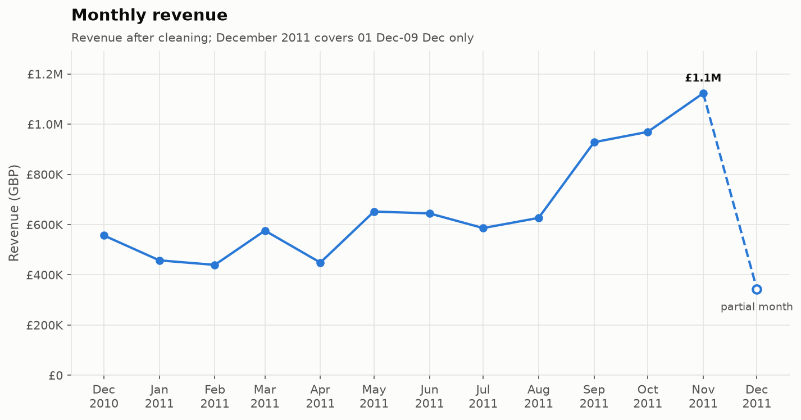
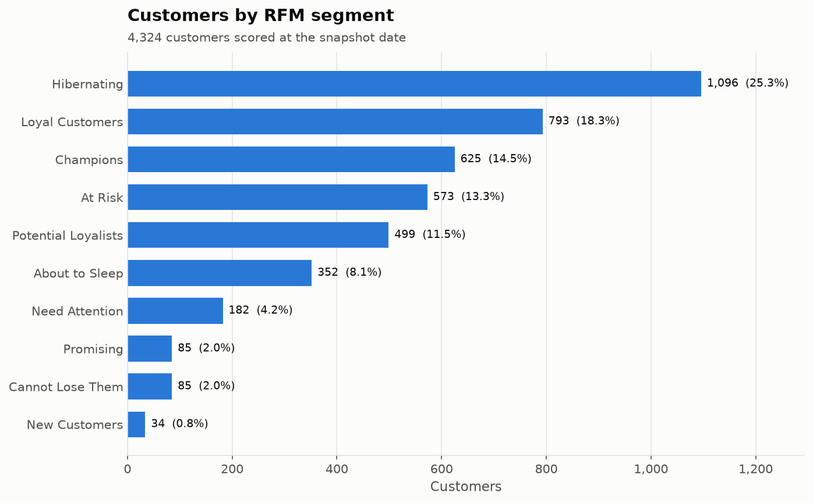
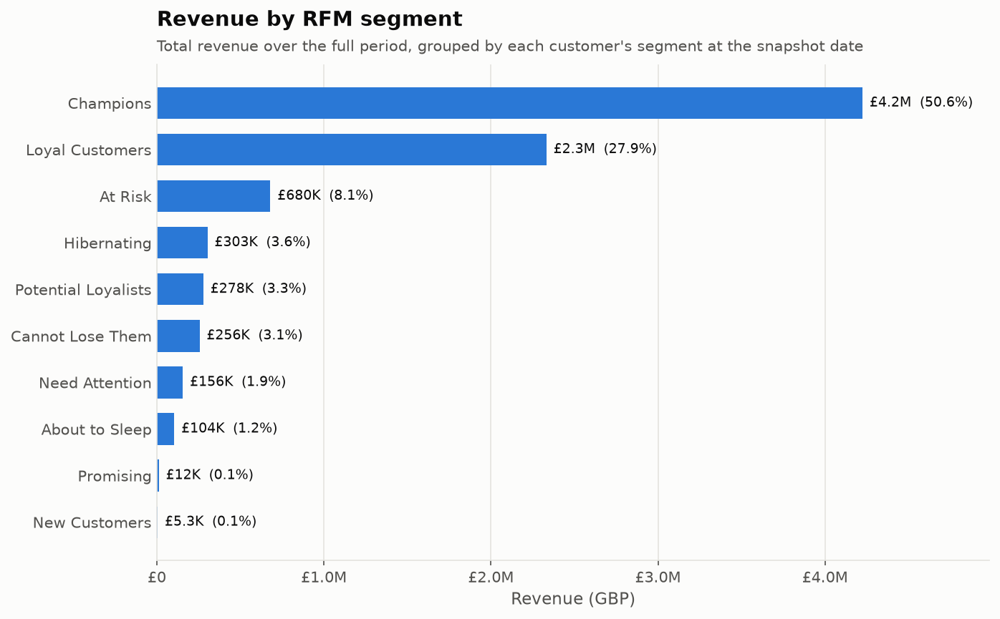
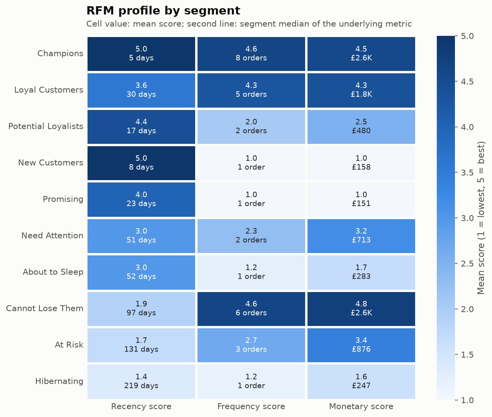
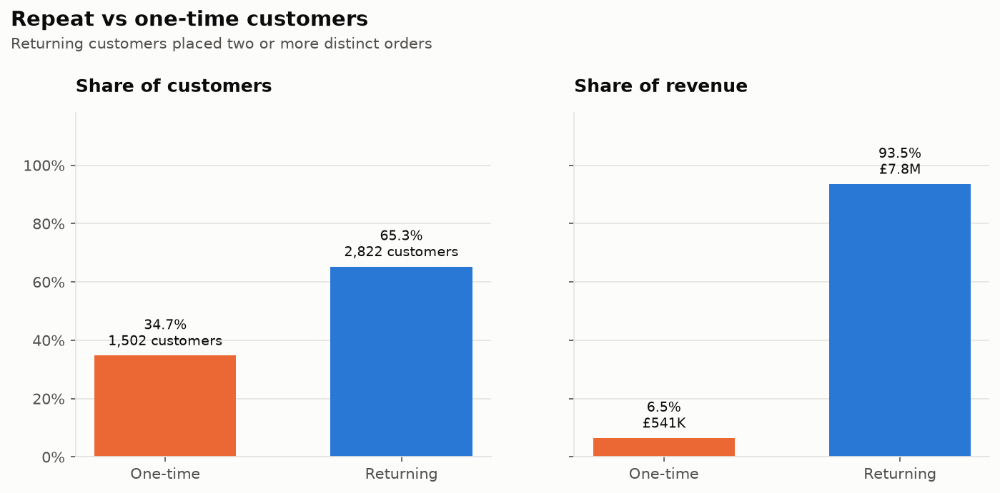
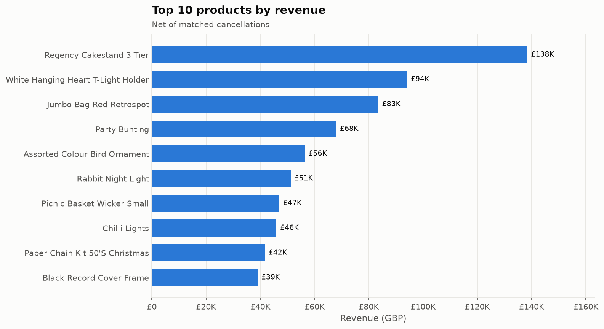
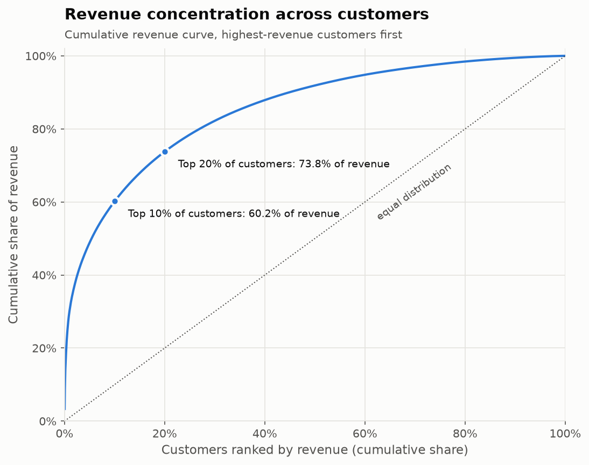
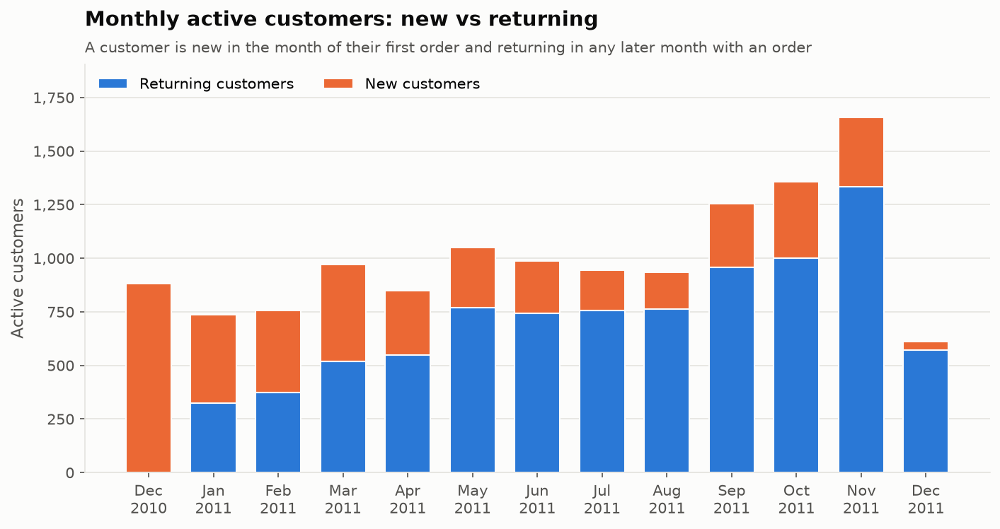
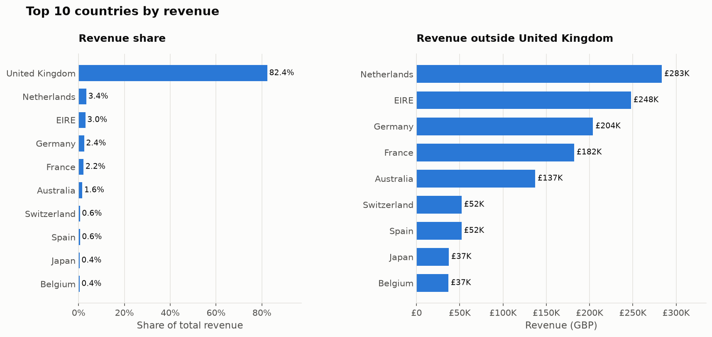
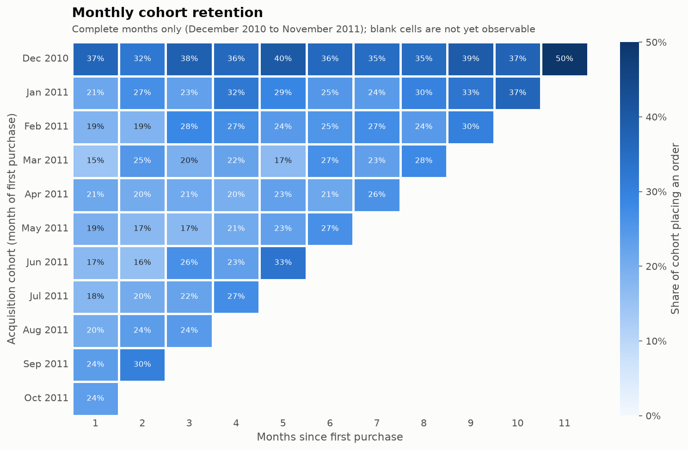

# Customer Behavior Analytics

A customer analytics project exploring purchasing behavior, RFM segmentation, customer retention, repeat purchases, and revenue patterns using Python, Pandas, and SQL.



## Contents

- [Project overview](#project-overview)
- [Business objectives](#business-objectives)
- [Dataset](#dataset)
- [Data dictionary](#data-dictionary)
- [Project architecture](#project-architecture)
- [Installation](#installation)
- [Running the analysis](#running-the-analysis)
- [Data cleaning methodology](#data-cleaning-methodology)
- [Exploratory analysis results](#exploratory-analysis-results)
- [RFM methodology](#rfm-methodology)
- [Customer retention methodology](#customer-retention-methodology)
- [Visualizations](#visualizations)
- [Business insights](#business-insights)
- [Testing](#testing)
- [Limitations](#limitations)
- [Future improvements](#future-improvements)

## Project overview

The project analyzes one year of transactions from a UK-based online retailer that sells giftware, mostly to wholesale customers. A reproducible pipeline downloads the public dataset, cleans and validates it, and then:

- calculates headline KPIs, product, country and order-frequency statistics
- segments customers with RFM (recency, frequency, monetary) scoring
- measures repeat purchases, monthly new and returning customers, and cohort retention
- analyzes revenue by month, quarter, segment, product, country and customer concentration
- reproduces the core metrics in SQL with DuckDB and checks them against the Pandas results
- saves charts, result tables and a metrics summary under `reports/`

Python and Pandas are the primary analysis tools. SQL is used for complementary analytical views.

## Business objectives

1. Understand overall sales performance and how it changes over time.
2. Identify the customer groups that drive revenue and those whose activity is fading.
3. Quantify how much the business depends on repeat customers and how well new customers are retained.
4. Find out where revenue is concentrated: customers, products and countries.
5. Turn the findings into actionable recommendations.

## Dataset

| | |
|---|---|
| Name | Online Retail |
| Source | UCI Machine Learning Repository, https://archive.ics.uci.edu/dataset/352/online+retail |
| Citation | Chen, D. (2015). Online Retail [Dataset]. UCI Machine Learning Repository. https://doi.org/10.24432/C5BW33 |
| License | Creative Commons Attribution 4.0 International (CC BY 4.0) |
| Period | 1 December 2010 to 9 December 2011 |
| Size | 541,909 invoice lines, 23.7 MB zip archive |

The data is not stored in this repository. The pipeline downloads the archive into `data/raw/` on first run. Customer identifiers are anonymous numeric codes, and the dataset contains no names, emails, addresses or other personal information.

## Data dictionary

Source columns are renamed to the project schema when the data is loaded (`src/data_loader.py`).

| Column | Source column | Type | Description |
|---|---|---|---|
| `order_id` | InvoiceNo | string | Invoice number. A leading `C` marks a cancellation. |
| `product_id` | StockCode | string | Product code. Non-merchandise codes such as `POST` or `M` are removed. |
| `product_name` | Description | string | Product description, normalized to the most frequent description for each product code. |
| `quantity` | Quantity | integer | Units on the invoice line. |
| `order_date` | InvoiceDate | datetime | Invoice timestamp. |
| `unit_price` | UnitPrice | float | Price per unit in GBP. |
| `customer_id` | CustomerID | string | Anonymous customer code. |
| `country` | Country | string | Country of the customer. |

Derived fields:

| Column | Description |
|---|---|
| `revenue` | `quantity * unit_price`, rounded to 2 decimals |
| `order_month` | First day of the order month |
| `order_quarter` | Calendar quarter, for example `2011Q3` |
| `order_day_of_week` | Weekday name |
| `order_hour` | Hour of the order timestamp |

## Project architecture

```
customer-behavior-analytics/
├── data/
│   ├── raw/                     downloaded archive and CSV cache (not tracked)
│   └── processed/               cleaned transactions and cancellations (not tracked)
├── notebooks/
│   └── customer_behavior_analysis.ipynb
├── reports/
│   ├── business_insights.md     findings and recommendations
│   ├── summary_metrics.json     headline metrics written by the pipeline
│   ├── figures/                 charts
│   └── tables/                  analysis tables, with SQL view exports in tables/sql/
├── sql/
│   ├── customer_metrics.sql     orders, customer summary, repeat metrics, RFM scores, cohorts
│   └── revenue_analysis.sql     monthly and quarterly revenue, countries, products, concentration
├── src/
│   ├── config.py                paths, dataset URL, column mapping
│   ├── data_loader.py           download, extract and standardize the raw data
│   ├── data_cleaning.py         cleaning rules, cleaning report, validation
│   ├── aggregations.py          shared order-level and customer-level tables
│   ├── exploratory_analysis.py  KPIs, products, order frequency
│   ├── revenue_analysis.py      revenue over time, concentration, customers, countries
│   ├── rfm_analysis.py          RFM scoring and configurable segmentation
│   ├── retention_analysis.py    repeat purchases, monthly activity, cohorts, lifetime revenue
│   ├── sql_analysis.py          DuckDB runner for the SQL views
│   ├── visualization.py         chart functions
│   └── pipeline.py              end-to-end command-line entry point
├── tests/                       pytest suite using a small synthetic sample
├── pyproject.toml
└── requirements.txt
```

Data flows in one direction: `data_loader` → `data_cleaning` → analysis modules → `pipeline`, which writes tables, figures and metrics. The notebook calls the same functions, so it produces the same numbers as the pipeline.

## Installation

Requirements: Python 3.10 or newer and an internet connection for the first data download.

```bash
git clone https://github.com/bsdgsmm/customer-behavior-analytics.git
cd customer-behavior-analytics
python -m venv .venv
source .venv/bin/activate
pip install -r requirements.txt
```

On Windows, activate the environment with `.venv\Scripts\activate`.

All dependencies are free and open source: pandas, NumPy, Matplotlib, seaborn, DuckDB, openpyxl, Jupyter and pytest.

## Running the analysis

Run the full pipeline from the project root:

```bash
python -m src.pipeline
```

The pipeline:

1. downloads `online_retail.zip` into `data/raw/` if it is missing and converts the Excel file to a CSV cache (about one minute, first run only)
2. cleans and validates the transactions, then writes `data/processed/transactions_clean.csv` and `data/processed/cancellations.csv`
3. runs every analysis and writes the CSV tables to `reports/tables/`
4. executes both SQL files with DuckDB and exports the views to `reports/tables/sql/`
5. regenerates all charts in `reports/figures/` and the metrics in `reports/summary_metrics.json`

Use `python -m src.pipeline --no-download` to fail instead of downloading when the raw data is missing.

To explore the analysis interactively:

```bash
jupyter notebook notebooks/customer_behavior_analysis.ipynb
```

To run the tests:

```bash
python -m pytest
```

## Data cleaning methodology

Rules are applied in order, and the number of rows each one removes is recorded in `reports/tables/cleaning_report.csv`:

| Step | Rows removed | Rows remaining | Reason |
|---|---:|---:|---|
| Raw rows | | 541,909 | |
| Invalid or missing order date | 0 | 541,909 | Dates must parse |
| Non-numeric quantity or unit price | 0 | 541,909 | Numeric fields must parse |
| Missing customer id | 135,080 | 406,829 | Customer-level analysis needs an identifier |
| Duplicate lines | 5,227 | 401,602 | Identical lines on the same invoice, compared after name normalization |
| Cancellation invoices | 8,872 | 392,730 | Kept separately in `cancellations.csv`, not counted as sales |
| Purchases reversed by a matching cancellation | 2,761 | 389,969 | See below |
| Non-merchandise codes | 1,501 | 388,468 | Postage, manual adjustments, bank charges, marketplace fees, discounts, samples, commissions, bad debt |
| Non-positive quantity | 0 | 388,468 | Already removed by the earlier rules |
| Non-positive unit price | 34 | 388,434 | Free or invalid prices |

Decisions:

- **Missing customer ids.** These rows are 24.9% of all lines. They cannot be linked to a customer, so they are excluded from all analyses, including revenue totals. All revenue figures therefore cover identified customers only.
- **Cancellations.** Invoices starting with `C` have negative quantities. Excluding only these invoices would leave the original purchases in the data, which inflates revenue: one order of 80,995 units was cancelled minutes later. Each cancellation line is therefore matched to the most recent earlier purchase with the same customer, product, unit price and quantity, and that purchase is removed as well. Each purchase can be matched only once. Partial cancellations, and cancellations of purchases made before the data starts, have no exact match. Those purchases stay in the data.
- **Product names.** Some codes have several spellings. Each code is mapped to its most frequent description.
- **Validation.** After cleaning, `validate_clean_transactions` checks that there are no missing customers or dates, no non-positive quantities or prices, no cancellations, no duplicate lines, and no order assigned to more than one customer. The pipeline stops if any check fails.
- **Partial months.** The data ends on 9 December 2011, so December 2011 is flagged as a partial month. Charts mark it, and it is excluded from the cohort tables.

## Exploratory analysis results

| Metric | Value |
|---|---|
| Revenue | £8,350,894 |
| Orders | 18,281 |
| Customers | 4,324 |
| Products | 3,646 |
| Countries | 37 |
| Units sold | 4,918,183 |
| Average order value | £456.81 |
| Average units per order | 269 |

- Monthly revenue ranged from £439K to £652K between January and August 2011, then climbed to £1.12M in November 2011. September to November produced 36.2% of total revenue.
- Quarterly revenue grew from £1.47M in Q1 2011 to £1.75M in Q2 and £2.14M in Q3.
- The United Kingdom contributes 82.4% of revenue. The Netherlands, EIRE, Germany and France follow.
- The most frequently ordered product is White Hanging Heart T-Light Holder, which appears in 10.8% of orders. The highest-revenue product is Regency Cakestand 3 Tier (£138K).
- 34.7% of customers ordered once, and 8.9% ordered ten or more times.

## RFM methodology

Implemented in `src/rfm_analysis.py` and reproduced in SQL in the `rfm_scores` view.

**Metrics.** The snapshot date is the day after the last transaction (10 December 2011) and can be set in `RFMConfig`.

- Recency: days from the customer's last order date to the snapshot date
- Frequency: number of distinct orders
- Monetary: total revenue

**Scoring.** Each metric is scored from 1 to `score_levels` (default 5) with a tie-aware percentile rank:

```
score = ceil(score_levels * rank_min(value) / customer_count)
```

`rank_min` gives tied values the lowest rank in their group, so customers with identical behavior always receive the same score. This matters for frequency, where 34.7% of customers have exactly one order. A plain quintile split would put customers with the same order count into different scores. For recency, lower values rank higher. The resulting score ranges from the actual data are saved in `rfm_score_thresholds.csv`:

| Score | Recency (days) | Frequency (orders) | Monetary (GBP) |
|---|---|---|---|
| 5 | 1 to 13 | 6 to 203 | 2,007 to 278,778 |
| 4 | 15 to 32 | 4 to 5 | 916 to 2,006 |
| 3 | 33 to 71 | 3 | 477 to 916 |
| 2 | 72 to 179 | 2 | 244 to 477 |
| 1 | 180 to 374 | 1 | 3 to 244 |

**Segments.** Frequency and monetary scores are strongly related, so they are combined into an FM score, the mean of F and M rounded half up. Each customer is placed in a segment by their position on the recency by FM grid:

| Segment | R score | FM score | Interpretation |
|---|---|---|---|
| Champions | 5 | 4 to 5 | Bought very recently, often, and spend the most |
| Loyal Customers | 3 to 4 | 4 to 5 | Frequent, high-value, recently active |
| Potential Loyalists | 4 to 5 | 2 to 3 | Recent, with moderate frequency and spend |
| New Customers | 5 | 1 | Very recent first purchases |
| Promising | 4 | 1 | Recent, low frequency and spend |
| Need Attention | 3 | 3 | Average on all dimensions |
| About to Sleep | 3 | 1 to 2 | Below-average recency, frequency and spend |
| Cannot Lose Them | 1 to 2 | 5 | Formerly top customers who have not bought for months |
| At Risk | 1 to 2 | 3 to 4 | Good customers who have not bought for months |
| Hibernating | 1 to 2 | 1 to 2 | Low value and long inactive |

The rules are `SegmentRule` objects passed in `RFMConfig`. Different score levels or segment definitions can be supplied. The configuration is checked when it is created, and every R and FM score pair must map to exactly one segment, so customers are never left unassigned or counted twice. Because scores are percentiles, the thresholds adapt to the data instead of relying on fixed day or currency cut-offs.

| Segment | Customers | Share | Revenue | Revenue share |
|---|---:|---:|---:|---:|
| Champions | 625 | 14.5% | £4,224,637 | 50.6% |
| Loyal Customers | 793 | 18.3% | £2,332,176 | 27.9% |
| Potential Loyalists | 499 | 11.5% | £278,478 | 3.3% |
| New Customers | 34 | 0.8% | £5,299 | 0.1% |
| Promising | 85 | 2.0% | £12,148 | 0.1% |
| Need Attention | 182 | 4.2% | £155,628 | 1.9% |
| About to Sleep | 352 | 8.1% | £104,334 | 1.2% |
| Cannot Lose Them | 85 | 2.0% | £255,559 | 3.1% |
| At Risk | 573 | 13.3% | £679,643 | 8.1% |
| Hibernating | 1,096 | 25.3% | £302,990 | 3.6% |

## Customer retention methodology

Implemented in `src/retention_analysis.py`. Definitions:

| Metric | Definition |
|---|---|
| Repeat customer | A customer with two or more distinct orders during the period |
| Repeat purchase rate | Repeat customers divided by all customers |
| Repeat customer revenue share | Revenue from repeat customers divided by total revenue |
| Days to second order | Days between a customer's first and second order |
| New customer in a month | A customer whose first order falls in that month |
| Returning customer in a month | A customer who orders in that month and first ordered in an earlier month |
| Acquisition cohort | Customers grouped by the month of their first order |
| Cohort retention, month *k* | Share of a cohort that placed at least one order *k* calendar months after the acquisition month |
| Average retention, month *k* | Sum of retained customers divided by the sum of cohort sizes, over all cohorts observable at month *k* |
| Cumulative revenue per acquired customer | Cohort revenue to date divided by the cohort's original size |
| Customer lifetime revenue | Total revenue from a customer during the observed period. This is a revenue measure, not profit or margin. |

Cells that are not yet observable, because the cohort is too recent, are left empty instead of being treated as zero. Cohort tables use complete months only, December 2010 to November 2011.

Results:

- 65.3% of customers are repeat customers, and they generate 93.5% of revenue.
- The median time from first to second order is 51 days, with an interquartile range of 20 to 112 days.
- For 2011 cohorts, month-1 retention ranges from 14.6% to 23.6%.
- Customer lifetime revenue has a median of £656 and a mean of £1,931. The 90th percentile is £3,494, so the distribution is highly skewed.

## Visualizations

All charts are generated from the cleaned data by `src/visualization.py`.

| | |
|---|---|
|  |  |
|  |  |
|  |  |
|  |  |



## Business insights

The full write-up is in [reports/business_insights.md](reports/business_insights.md). Key points:

1. **Champions and Loyal Customers drive the business.** They make up 32.8% of customers and 78.5% of revenue. Protecting their order frequency matters more than any other lever.
2. **High-value customers are lapsing.** Cannot Lose Them and At Risk together represent 658 customers and £935K of historical revenue. Their revenue in the last 90 days is 70% and 48% below the previous 90 days. Part of this drop follows from how the segments are defined, but the value at stake justifies a measured win-back campaign.
3. **The second order is the key step.** 34.7% of customers never return, and the median repeat buyer comes back after 51 days. Follow-up within that window can be tested.
4. **Revenue is concentrated.** The top 1% of customers (43) generate 30.1% of revenue, and the top 20% generate 73.8%. Key-account monitoring reduces this risk.
5. **International revenue depends on a few accounts.** The Netherlands and EIRE contribute 6.4% of revenue from 12 customers. Germany and France have broader customer bases and are better suited to growth tests.
6. **Revenue peaked from September to November 2011**, with 36.2% of annual revenue. One year of data cannot confirm whether this repeats every year.
7. **Cancellations are material.** £608,689 of cancellation lines, including fully reversed bulk orders, should be reviewed.

## Testing

`tests/` contains 53 pytest tests that run on a small synthetic sample, so they need no download:

- loader: column mapping, types, archive round trip, error handling
- cleaning: the row count for each rule, cancellation matching, row accounting, validation
- exploratory and revenue analysis: KPIs, rankings, period totals, partial-month detection, concentration
- RFM: percentile scores and ties, snapshot handling, segment mapping, rule validation, summaries
- retention: repeat metrics, monthly activity, cohort counts with observability, retention curve, lifetime revenue
- SQL: every view executes, and SQL results match the Pandas implementation, including RFM scores and cohort counts
- visualization: every chart renders and closes its figure

```bash
python -m pytest
```

## Limitations

- **Unidentified customers.** Lines without a customer id are excluded. They are 24.9% of lines and about 16% of positive line value. Revenue totals are therefore lower than the retailer's actual sales.
- **One year of data.** Seasonality cannot be separated from growth, and long-term retention cannot be measured.
- **Left-censoring.** Customers active before December 2010 appear as new in the December 2010 cohort. This inflates that cohort's retention and the share of new customers in the first month.
- **Partial cancellations.** Only exact one-to-one reversals are removed. Partial cancellations and cancellations of purchases made before the data starts remain unmatched.
- **No cost data.** Lifetime revenue is not profit or customer lifetime value in the margin sense.
- **Wholesale mix.** Many customers are businesses, so a few accounts dominate some countries and segments.
- **Segment-based activity trends.** RFM segments use recency at the snapshot date, so comparing their recent activity partly reflects how they are defined.
- **No causal inference.** All findings are descriptive. Recommendations should be validated with controlled experiments.

## Future improvements

- Add the UCI Online Retail II dataset (2009 to 2011) for a second year and year-over-year comparisons.
- Model churn probability and predicted future revenue with probabilistic models such as BG/NBD and Gamma-Gamma.
- Add market-basket analysis (association rules) for product bundling.
- Add an interactive dashboard on top of the exported tables.
- Track segment migration between snapshot dates.

## License

The source code is released under the MIT License. See [LICENSE](LICENSE). The dataset is licensed separately under CC BY 4.0 by its authors.
